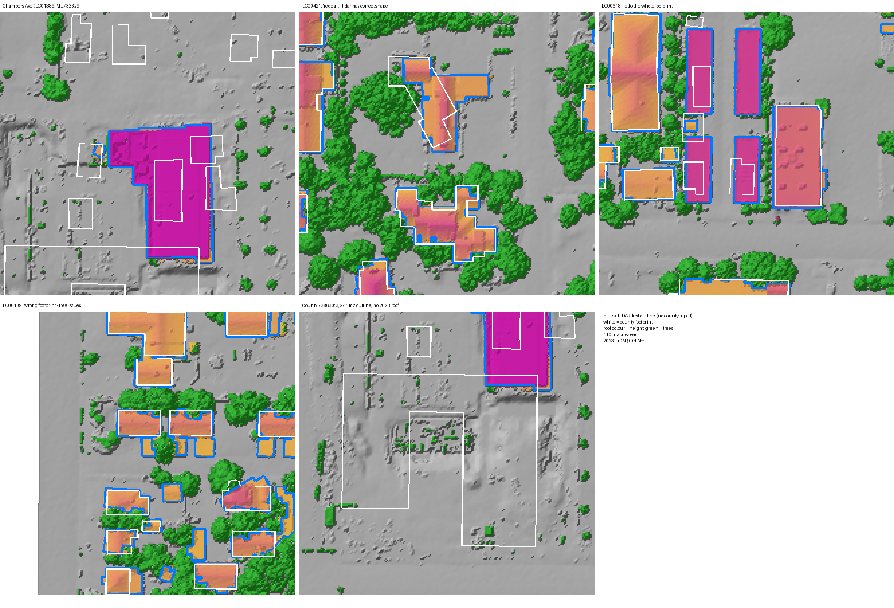
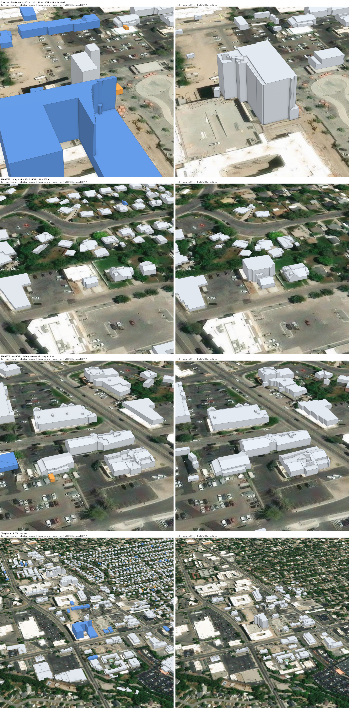

# LiDAR-first building outlines (October 26, 2026)

**Brian's decision, October 26:** for whole buildings, the LiDAR is right more often than the county footprints, and it
is newer. So the county footprints should be redrawn from the LiDAR, not kept and patched with LiDAR pieces. His
words: "we need to just get rid of those and take the LiDAR as the truth over the county footprints". The decision came
from his answers and notes on the LiDAR candidates, the possible new buildings and the roof fallbacks (LC00421 "redo all
- lidar has correct shape", LC00618 "redo the whole footprint", NB0020 "one building is gone the lidar is correct",
LC01389). **Unvalidated planning estimates from the 2023 LiDAR (October-November); nothing is uploaded or edited.**

## Why the candidates came out in pieces

The October 23 candidates ([lidar_candidates.py](../../2026-10-23/footprint-candidates/lidar_candidates.py)) kept only
roof cells **more than 1.5 m from every county footprint**. A LiDAR building that overlapped a wrong county outline was
cut into the part outside it, and the rest showed up as an "offset or rebuilt" pair. The outlines here use the same rules
without that step (`clusters(..., exclude_m=None)`): every 2-of-3 consensus roof cluster after a 3 × 3 opening, at least
10 m² and 2 m median height, regularized the same way. The county layer is used only afterwards, to compare.

## How the county layer compares

[lidar_footprints.py](lidar_footprints.py) `compare` groups county footprints and LiDAR outlines that overlap (at least
10% of the smaller one) and gives each group one class. The pilot covers 426000-430500 E, 4504500-4507200 N, about
40% of the city and most of Brian's examples:

| Class | Groups | County footprints | Meaning |
|---|---:|---:|---|
| MATCH | 6,240 | 6,240 | one each, intersection over union at least 0.6 |
| RESHAPED | 844 | 844 | one each, IoU under 0.6: offset, wrong shape or rebuilt |
| LIDAR_JOINS | 482 | 1,064 | one LiDAR building over several county footprints |
| LIDAR_SPLITS | 49 | 49 | one county footprint over several LiDAR buildings |
| TANGLE | 4 | 9 | several of each |
| LIDAR_ONLY | 903 | 0 | no county footprint |
| COUNTY_ONLY | 406 | 406 | no LiDAR roof: 289 have 30% or more canopy over them, 179 are under 20 m² |

**Against Brian's answers in the window:**
- 23 of the 27 candidates he accepted are LIDAR_ONLY. The other four are reshaped, joined or matched groups, where his
  candidate was a piece of a whole LiDAR building.
- His "part of the existing building" candidates fall in MATCH (5): the piece is part of one whole LiDAR building.
- His "both real" pairs are LIDAR_SPLITS.
- The roof fallbacks he called simple-but-fine, gone, under trees or unsure are COUNTY_ONLY. The LiDAR has too little
  roof there to draw an outline, which is why they fell back.

**Citywide** (the same run without a window; `runs\lidar-footprints-20261026\city`): 23,327 LiDAR outlines against
22,042 county footprints.

| Class | Groups | County footprints |
|---|---:|---:|
| MATCH | 17,245 | 17,245 (78%) |
| RESHAPED | 1,636 | 1,636 |
| LIDAR_JOINS | 1,023 | 2,260 |
| LIDAR_SPLITS | 137 | 137 |
| TANGLE | 13 | 31 |
| LIDAR_ONLY | 3,080 | 0 |
| COUNTY_ONLY | 733 | 733 (480 with 30% or more canopy over them) |

The median eave offset on MATCH groups is again 0.39 m (quartiles 0.16-0.58 m).

Against all of Brian's answers so far:
- All 5 pairs he called REBUILT are COUNTY_ONLY: the old county building has no 2023 roof.
- Both OFFSET pairs are RESHAPED.
- 26 of his 34 accepted candidates are LIDAR_ONLY.
- His 16 "part of the existing building" candidates are 9 MATCH, 4 RESHAPED and 3 LIDAR_JOINS, all one whole LiDAR building.

The LiDAR-only groups (3,080) are fewer than the October 23 candidates (6,213), because a piece against a county
building is now part of that building's whole outline.

**Chambers Avenue** (LC01389, LC01423, MD733329) is one LiDAR building of 1,418 m². The county has three outlines over
it, totalling 481 m², and more around it for buildings that are gone. County 738630, a 3,274 m² outline nearby, has no
2023 roof at all.



## Where the LiDAR is not the truth

- **Under trees** the LiDAR sees only part of a roof, so its outline is a lower bound there (LC00109, MD733380
  "covered with trees and not the full roof"). COUNTY_ONLY groups under canopy are hidden buildings, not demolitions.
- **Small buildings:** sheds and garages under about 10 m², or with too few roof returns, have no LiDAR outline. 179 of
  the 406 county-only footprints are under 20 m².
- **Eaves:** on MATCH groups the LiDAR edge sits a median 0.39 m outside the county outline (quartiles 0.15-0.58 m). The
  LiDAR traces the drip line and the county the walls. Nothing was shrunk; whether the product should be the roof
  outline or a wall line is Brian's call.
- **Attached units:** LIDAR_JOINS includes townhouses and duplexes, where the county splits one roof by unit. The LiDAR
  outer shape is right, but it cannot see party walls. Addresses, parcels and year built live on the county rows and
  would be carried across.
- **Date:** the LiDAR is October-November 2023. Buildings since then are the new-building hints' job, from imagery.

## Roofer on the LiDAR outlines: Chambers Avenue pilot

Brian asked to see roofer LoD2.2 on the LiDAR-first outlines next to the current hybrid. [roofer_pilot.py](roofer_pilot.py)
takes a 500 m square around the Chambers Avenue site and runs roofer exactly as the October 24 citywide v2 run did. It
uses the same consensus roof and ground points, roofer 1.0.0, `--lod22 --plane-detect-min-points 30` and the same
conversion to a scene layer package. Only the footprints change: the 62 LiDAR outlines lying wholly inside the square
(one outline in two parts became two footprints). Roofer modelled 62 of the 63 parts. The package validates; its one
warning, about vertex normals, is the same as the earlier packages'.



- **Chambers Avenue:** the hybrid has a large blue Esri LOD2.0 block standing on the empty lot. It was built from
  county 738630, a 3,274 m² outline with no 2023 roof, so the building is gone. The new tower appears only as a thin grey sliver
  modelled on a county outline. On the LiDAR outline roofer models the whole tower (1,418 m²), and the lot is empty,
  as in the imagery.
- **LB005398:** the county has an 83 m² outline, so the hybrid models a small box beside an unmodelled flat roof. The LiDAR
  outline (382 m²) gives the whole building, including its taller part.
- **LB005619**, one LiDAR building over several county outlines: nearly the same either way.
- In the block view the right panel has only the pilot square; outside it the roofs are imagery.

Of the 62 buildings in the square, 29 match a county footprint, 16 have none, 11 are reshaped, 4 sit over several
county outlines and 2 are split. The October 24 citywide roofer step took about 15 minutes for 52 tiles, so a citywide
LiDAR-first run is about an hour with conversion.

View it (ArcGIS Pro Python; port 8812 may be held by an older viewer):

```
python reviews/2026-10-23/lod2-check/viewer/serve_scene.py OUT\viewer-shots --slpk now=<v2>\buildings_hybrid_v2.slpk --slpk lidar=<pilot>\lidar_first_pilot.slpk --web reviews/2026-10-26/lidar-footprints/viewer --port 8813
```

`state.shoot(i)` in the page saves both panels of bookmark i to OUT. The pilot outputs are in
`runs\lidar-footprints-20261026\roofer-pilot-chambers`. The first attempt, which stopped on the two-part outline,
is kept as `roofer-pilot-chambers.failed-duplicate-id`.

## Citywide rebuild and private upload (October 26)

[lidar_first_city.py](lidar_first_city.py) ran the pilot's setup on all 23,490 outline parts (52 tiles). Roofer
modelled 23,420 of them in 11 minutes of roofer time, and 23,373 have LoD 2.2 solids. On one tile cjio's triangulator hung
(no crash, no exit) on a batch of 615 buildings. The export now times out (30 s plus 0.2 s per building) and halves the
batch, as it already did for crashes ([roofer_city_stages.py](../../2026-10-23/lod2-check/roofer_city_stages.py)). The
smaller batches exported normally, so the hang was intermittent.

The candidate holds the 23,373 LiDAR-outline buildings and the v2 model of 220 county footprints whose roof the LiDAR
cannot see (no 2023 roof, 30% or more canopy). The other 260 such footprints have no v2 model either. Total 23,593:
23,420 roofer LoD2.2, 50 Esri LOD2.0, 123 Esri LOD1.2. LiDAR rows carry roof_attributes.py's roof measurements, the same
fields as v2, and the compare class and county IDs of their group.

**Units, as Brian asked on October 26: metres kept, feet added beside them in the same layer.** This is one change, not a
feet-only version. Every `_M` field has an `_FT` twin, every `_M2` a `_SQFT` and `_M3` a `_CUFT`, and the elevations and
the fit error a `_FT` twin: 19 pairs. Each value was converted back and matched within 4e-12.

**Uploaded privately** through `upload.py buildings3d_lidar_first --go`:
- scene layer `de1adcb1da154620a1949181ab324747`;
- source package `e1df868f92034a409fb2d60123eec04d`;
- 34,469,880 bytes, SHA-256 8c6cf6f8...b572.

The hosted layer has 68 fields. Its statistics match the package: 23,593 buildings, the FP_ID sum, the model and
outline-source counts, and the height sums in metres and feet. Not shared. The public buildings scene still points at
the v2 layer, and its pop-ups still show feet only. Repointing the scene and giving its pop-ups both units is the next,
separate step, on Brian's approval.

FP_ID is not unique across the two sources: the 220 county rows keep the v2 massing numbering, which can collide with the
LiDAR numbering (LB number x 10 + part). Use LB_ID for LiDAR rows and SOURCE_ID for county rows.

## Public release (October 26)

Brian approved repointing the public buildings scene to the LiDAR-first layer, with pop-ups in metres and feet, as one
change, keeping the old layer for rollback. [release/release_lidar_first.py](release/release_lidar_first.py) did it in
the October 25 order:
1. snapshots in `release/evidence/before-*.json`;
2. a plan prepared offline and checked against the layer's 68 fields;
3. the new layer and its package delete-protected, the layer's text, pop-up and renderer written, and the layer shared
   publicly and checked anonymously;
4. only then the scene's building node repointed. Its node id, camera, slides, terrain and other layers are kept.

- **Pop-up:** reads the stored metres and feet fields, for example "Building height (ridge) 31.1 m (102.2 ft)" and
  "Roof plan area 1,395 m² (15,014 sq ft)". It also gives the outline source and the comparison with the county
  footprints, with their IDs.
- **Renderer and legend:** the live breaks and colours, now on building height above ground (ridge; the county median
  for kept county footprints). Labelled in both units, "Up to 4 m (13.1 ft)" to "Over 12 m (39.4 ft)". The old ramp used a
  county-only field, so the LiDAR buildings would have had no colour.
- **Revision:** one revision dropped a duplicate ridge row. The first applied plan is kept as
  `release-plan-applied-1.json`.
- **Verified signed out:** the scene matches the plan, and so does the layer's item data. The new layer is public and
  protected, the v2 layer stays public, and the package stays private. The hosted FP_ID sum and outline counts match.
  [viewer/public-check.html](viewer/public-check.html) loaded the scene anonymously and opened the pop-ups of the
  Chambers tower, LB005619 and LB005398.
- **Rollback:** `release_lidar_first.py rollback --go` puts the scene back on the v2 layer.

Not changed: the Azure download (still the v2 package and feet CSV), the private Buildings in 3D app's text, and the
hosted 2D building-heights layer. These are in [DECISIONS.md](DECISIONS.md).

## Review queue: LiDAR outlines vs county

[add_outline_queue.py](add_outline_queue.py) added 6,622 items to the review page, one per compare group that is not a
MATCH: 1,636 reshaped, 1,023 joined, 137 split, 13 tangles, 733 county-only and 3,080 LiDAR-only. Each class starts with
a random sample of 40 (seed 20261026), so its default in [DECISIONS.md](DECISIONS.md) can be settled from the sample.
Red is the LiDAR outline and magenta the county one. Answers: LIDAR_RIGHT, KEEP_UNITS, COUNTY_RIGHT, GONE, UNDER_TREES,
NOT_A_BUILDING, NEEDS_EDIT, SHED, UNSURE. The earlier items and Brian's answers were checked unchanged.

## Files

| File | Meaning |
|---|---|
| [lidar_footprints.py](lidar_footprints.py) | `detect` (ArcGIS Pro Python; `--window` for a pilot) and `compare` (ArcPy-free, with the answers cross-tab) |
| [lidar_first_city.py](lidar_first_city.py) | the citywide rebuild: prep, run, convert, compose (candidate package with feet beside metres) |
| [roofer_pilot.py](roofer_pilot.py), [viewer/](viewer) | the Chambers Avenue roofer pilot and its two-panel viewer; [roofer-pilot-comparison.png](roofer-pilot-comparison.png) |
| [pilot-examples.png](pilot-examples.png) | the five examples above, drawn on the review page's LiDAR view |
| `runs\lidar-footprints-20261026\pilot`, `...\city` | `lidar.gdb\buildings`, `clusters.tif`, `stage.tif`, `detect.json`, `compare.csv` (one row per group), `compare.json` |
